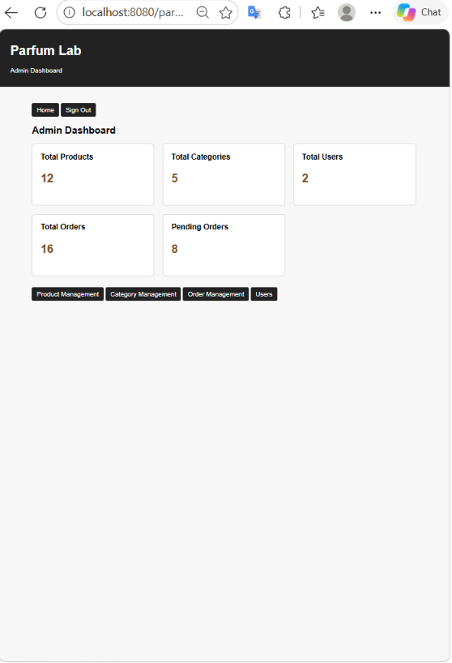
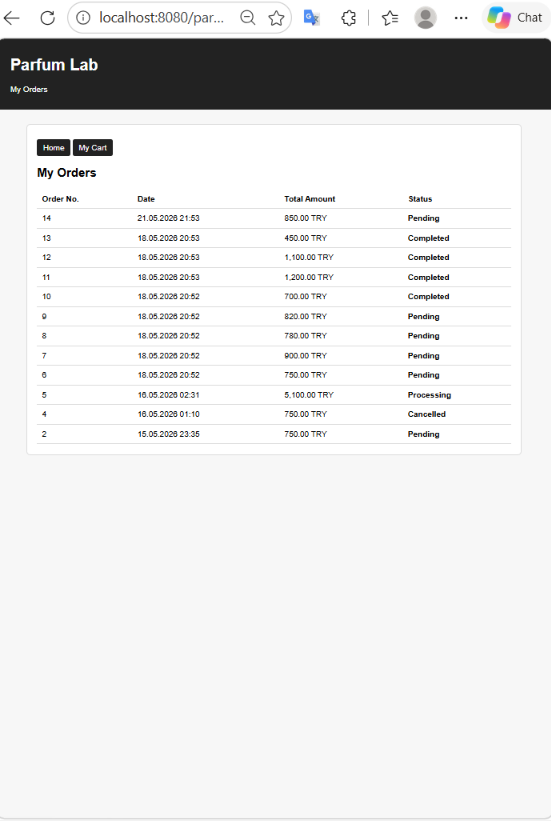

# Parfum Lab E-Commerce

A Java web application built as an individual university web programming project. It demonstrates a traditional Servlet/JSP architecture and relational database access with JDBC.

## Features

- Product catalog and category filtering
- Customer registration, login, shopping cart and order history
- Admin dashboard, product and category activation, stock updates and order status management
- Transactional order creation with stock checks

## Technology stack

Java 17+, Java Servlets (javax.servlet 4), JSP/JSTL, JDBC, MySQL 8, Maven and Apache Tomcat 9.

## Architecture

`Browser → Servlet → DAO → JDBC → MySQL`  
JSP renders the views; Java models represent the application data.

## Run locally

1. Install JDK 17 or 21, Maven, MySQL 8 and Tomcat 9 (not Tomcat 10+).
2. For a **fresh database**, run `database.sql` in MySQL Workbench. For an **existing installation**, back up your database and run `upgrade-to-english.sql` instead. Do not import the fresh seed over your existing data.
3. Configure `DB_USERNAME` and `DB_PASSWORD` in the environment of the Tomcat process. A dedicated database account is recommended; do not commit credentials. The app uses `localhost:3306/ecommerce_db`.
4. From the repository root run:
   ```sh
   cd ecommerce-web
   mvn clean package
   ```
5. Deploy `target/parfum-lab.war` to Tomcat 9's `webapps` directory and start Tomcat.
6. Open http://localhost:8080/parfum-lab/home . Register a local test account in the app. To make it an administrator, use MySQL as an authorized administrator and update that account's role, for example:
   ```sql
   UPDATE ecommerce_db.users SET role = 'ADMIN' WHERE email = 'your-demo-email@example.invalid';
   ```
   Sign out and back in to refresh the role. No default user credentials are included.

## Scope and limitations

This is a local educational demo, not a production store. New passwords are hashed with salted PBKDF2-HMAC-SHA256; existing legacy accounts are upgraded on successful login. Unused legacy accounts must be reset or migrated before any public deployment. Full CSRF protection, comprehensive input validation and automated integration tests are outside the current scope. No payment processing is included.

## Screenshots

### Home Page


### Admin Dashboard


### Order History


### Registration


