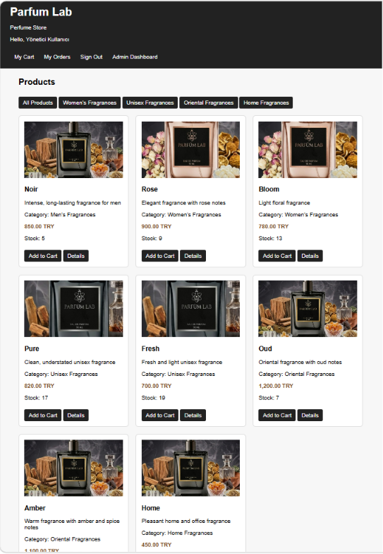
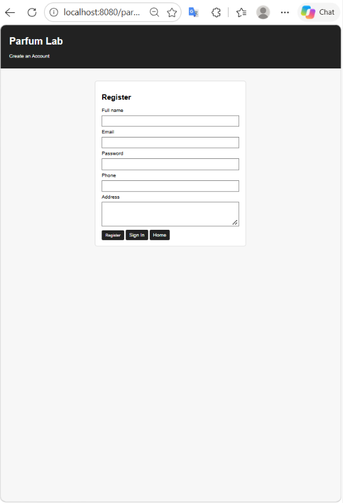

# Parfum Lab E-Commerce

A Java-based e-commerce web application developed as an individual university project.

## Features

- User registration and authentication
- Product catalog and category filtering
- Shopping cart and order history
- Admin dashboard
- Product, category and inventory management
- Order management

## Technologies

Java 17+, Servlets, JSP, JSTL, JDBC, MySQL, Maven, Apache Tomcat 9.

## Architecture

MVC-style architecture with a DAO layer for database access.

## Getting Started

1. Install JDK 17 or 21, Maven, MySQL 8 and Tomcat 9.
2. Import `database.sql` for a fresh database.
3. Set `DB_USERNAME` and `DB_PASSWORD` as environment variables.
4. Build the project:

   ```bash
   cd ecommerce-web
   mvn clean package
   ```

5. Deploy `target/parfum-lab.war` to Tomcat.

Open: http://localhost:8080/parfum-lab/home

## Screenshots

### Home Page


### Admin Dashboard


### Order History


### Registration


## Limitations

Educational project without payment processing, full security hardening or automated integration tests.
